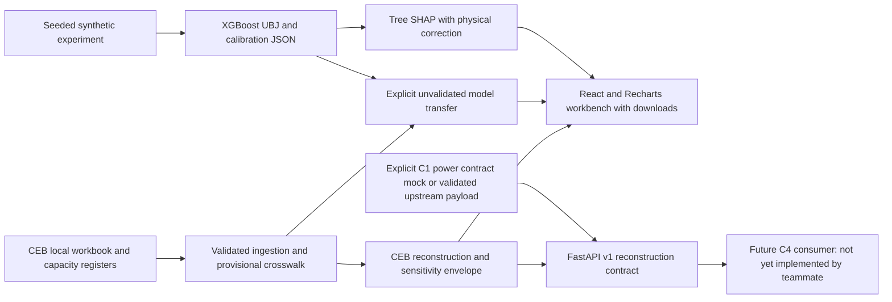

# Architecture and integration

## Actual teammate inspection

Inspected main and remote references fetched from origin: `feature/c1-solar-forecasting`, `feature/c3-grid-risk-assessment`, `feature/c3-risk-model`, `feature/c3-risk-experiments`, `feature/c3-c4-integration`, and `feature/c4-curtailment-prioritizer`. Main C1 feature/model files predict **clear_sky_index**, with CSI lag/rolling variability and clock inputs, through LightGBM. No live feeder-power forecast service exists there. The historical `schemas/contracts.py` on the older C3 scaffold branch defines `SolarForecast(p10_kw,p50_kw,p90_kw)`, but those schemas/services are absent on main. C2 implements an explicit adapter for this contract, not an import of an absent module.

Main C3's `aggregate_solar.py` parses summary and detail registers by column position and cross-checks capacities; its behavior guided the independent C2 parser. `link_loads.py` builds `'CSE'+SIN`, which cannot establish universally verified transformer matches. C2's static adapter requires an explicit SectionId. Current C3 integration uses `csc,gss,feeder,section,sin,kva,solar_kw,model_load_kw`, exposure/ranking/confidence fields, and EPSG:5234 to EPSG:4326 conversion for UI. Its static kW is never used as measured true-demand labels by C2.

C4 feature branch exposes FastAPI plus Pydantic ramp-event, grid-risk and solar-plant contracts. Its ramp deltas and plant capacities are MW, risk scores 0–100, asset types TRANSFORMER/FEEDER. `CurtailmentRequest` needs target_reduction_mw and operator_authorized. **No C2 demand-threshold input exists in that implementation.** C2 publishes its own versioned output and makes no automatic curtailment request. C4 adoption and end-to-end team integration remain a joint task. No teammate branches were merged and no teammate files were changed.

## REST contract

`GET /health` reports API status, actual model-load availability and false live-integration flags. `POST /v1/reconstruct` accepts `method=direct_solar_addition|xgboost`, positive finite `threshold_mw`, and 1–40,000 `records`. Each record requires:

| Field | Meaning |
|---|---|
| feeder_id | Explicit string ID, no implicit name matching |
| timestamp | ISO 8601 offset-aware interval timestamp |
| units | Exactly `MW` |
| net_mw | Finite signed net import MW or null for missing |
| solar_low_mw, solar_mw, solar_high_mw | Ordered nonnegative interval power estimates |
| capacity_mw | Nonnegative installed AC-bound capacity; high solar cannot exceed it. XGBoost requires positive capacity; use direct reconstruction for no-PV feeders. |
| provenance | Explicit origin and measured/estimated/synthetic interpretation |

Example record: `{"feeder_id":"MOCK_F1","timestamp":"2026-07-01T12:00:00+05:30","units":"MW","net_mw":-1,"solar_low_mw":1,"solar_mw":2,"solar_high_mw":3,"capacity_mw":4,"provenance":"explicit local integration mock"}`. Wrap in `{"records":[...],"threshold_mw":3}`.

Response envelope: `schema_version=c2.tla.v1`, timezone, boundary and records. Every record includes apparent/net, hidden, true, residual, true limits (MW), VLI (dimensionless or null), peak/reverse-flow/threshold indicators, method, provenance and quality flags. Model outputs add raw hidden and physical-correction MW. Missing true demand produces `threshold_status=unknown_missing_measurement`. Serialization emits aware UTC ISO timestamps; no NaN/Infinity JSON is emitted. The UI CSV preserves the equivalent +05:30 offset.

Duplicate keys, naive timestamps, non-finite values, inconsistent interval spacing, invalid units and solar bounds yield 422 errors. Exact feeder/timestamp joins reject missing C1 matches; no interpolation, fuzzy mapping or CSI-as-MW conversion occurs. Tests use an explicitly labelled local mock. CSI conversion requires clear-sky AC MW for the same feeder and time; deriving this reference remains a documented modelling responsibility.

`C2_TLA_API_TOKEN` enables Bearer authentication. Loopback-only defaults support independent local use. HTTPS, credential management and operator governance must be configured before remote deployment. API outputs provide information, not autonomous switching or curtailment actions.

## React workbench migration

The UI now matches main's C3 React design tokens (#1B1D1C charcoal, #D7FA75 lime, #A996F3 lilac), pill navigation, rounded statistic cards, filter panels, tables and Recharts styling. It uses the same React, Recharts, Lucide and Vite versions found in that frontend. C3/C4 source files are unchanged; no whole teammate branch is merged.

FastAPI serves `/` from the local Vite production build and `/C2_TLA_assets/` from its prefixed assets directory. The workbench uses same-origin authenticated endpoints: `GET /v1/dashboard/bootstrap`; `POST /v1/dashboard/catalog`, `/analyze`, `/explain`, and `/export?format=csv|json`. Requests identify `source=ceb|synthetic`, optional `ceb_path`, exact feeder ID, local start/end dates, method, positive MW threshold and bounded solar sensitivity assumptions. Catalog replies define valid source-specific feeder/date options. Analysis replies retain per-interval provenance, units, uncertainty, flags and indicators, plus summaries, consistency and explicitly synthetic benchmark evidence. Explanations sample up to 384 evenly spaced intervals, with global contributions, raw prediction/base and physical correction.

Source-data caching keys include the selected path and actual workbook modification signatures. Parameter changes recompute estimates without reparsing unchanged sources. An invalid explicit CEB path never falls back to synthetic data or the default cache. Source changes reset feeder/date selections. No Python/Node implementation details are inserted into the normal operator flow.

React build instructions are in the README. The previous Streamlit app is preserved in Git history and removed from the active tree to avoid competing interfaces. Existing `/v1/reconstruct` consumers and model files remain compatible. The UI runs at port 8502 by default; its API/docs are on the same port, with an optional separate port-8002 API launcher.
