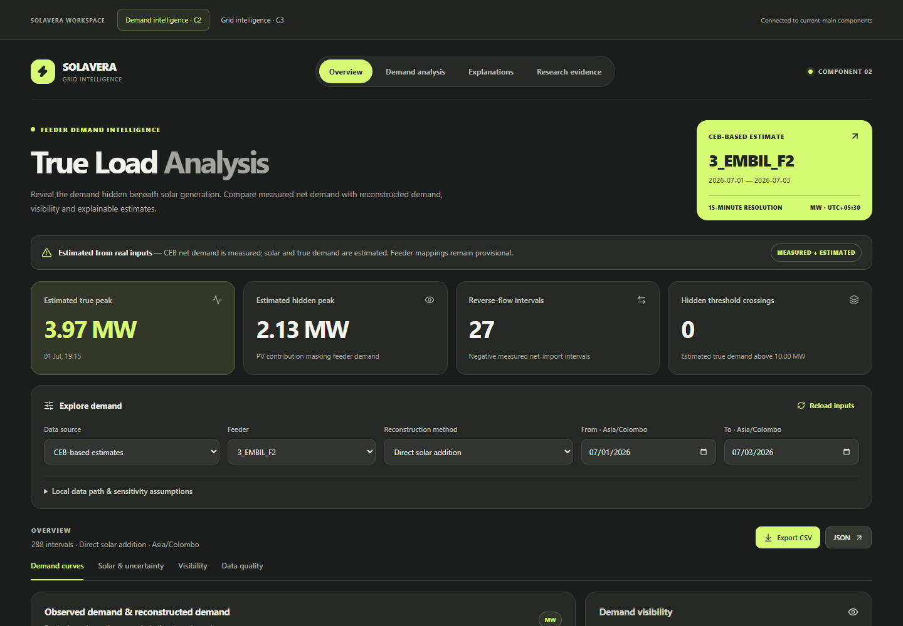
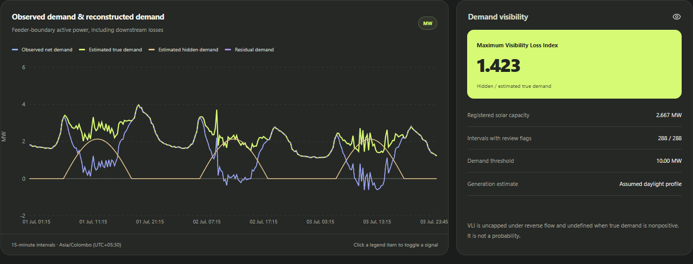
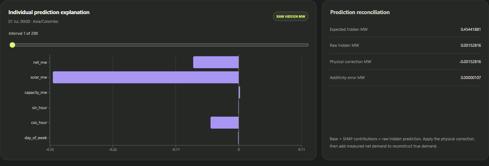
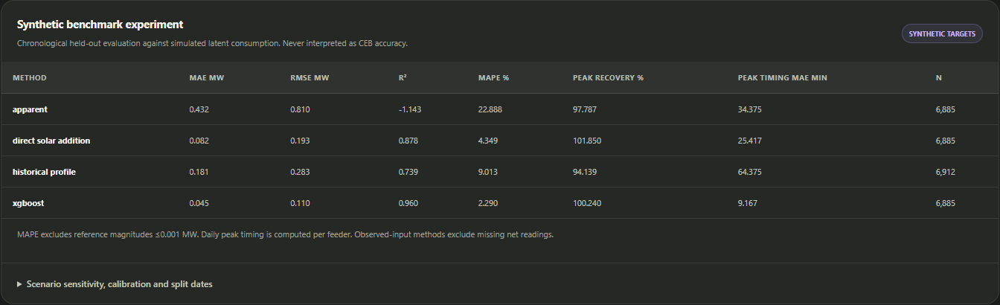
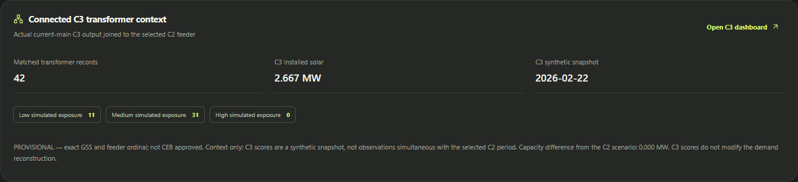

# True Load Analysis
## Component 2 — implementation, experiments and supervisor review

Prepared for Vinuki Charithma | 22 October 2026

Project: SOLAVERA | Repository: J26-DS-305 | Implemented software baseline: d4307b8

This report describes Component 2 as implemented and tested. It focuses on C2; other components are described only where they connect to it. Numbers are taken from the saved local artefacts, rather than proposed targets. This is an implementation and research-review document, not evidence of field-certified accuracy.

## Reading guide

Sections 1–5 explain the research problem, evidence and architecture. Sections 6–11 explain the methods, model, training and results. Sections 12–14 cover outputs, experiments and integration. Sections 15–16 explain the complete C2 dashboard and demonstration. Sections 17–20 cover limitations, supervisor questions, reproducibility and presentation wording. Appendices provide the file inventory, glossary and evidence references.

## 1. What has been built

Component 2 estimates the demand obscured by distributed rooftop photovoltaic generation at a feeder import boundary. The deliverable combines actual CEB input processing, explicit physical reconstruction, a supervised synthetic-data experiment, explainability, evaluation, a typed API and a working React dashboard. It is an analysis and decision-support prototype; it does not control the electricity network.

The main real-data workflow reads measured feeder net active power, joins an explicit solar-capacity register, estimates a daylight PV profile, and adds that estimate back to the net reading. A separate XGBoost experiment learns the simulated latent PV contribution from inference-available inputs. Both methods produce reconstructed demand, hidden contribution, visibility and threshold indicators. The dashboard lets a reviewer inspect the evidence and assumptions alongside these outputs.

The distinction between the two workflows is central. CEB net demand is measured. The solar estimate and reconstructed demand are model-derived. Synthetic experiments contain known latent labels by construction, allowing supervised evaluation. Those labels were not received from CEB. Software tests verify implementation behaviour, while field validation remains outstanding.

| Delivered capability | Implemented behaviour | Evidence boundary |
|---|---|---|
| CEB ingestion and audit | Reads actual Excel layouts; audits workbook, CSV, image and Access evidence | Not every supplied file is a model input |
| Direct reconstruction | Adds a capacity-based estimated PV profile to measured net MW | Conditional on mapping, capacity and electrical assumptions |
| XGBoost experiment | Predicts hidden PV MW, then adds net MW | Trained on synthetic targets only |
| Explanation | Individual and global Tree SHAP, with physical correction separate | Explains this model; not a causal study |
| Evaluation | Four benchmark methods, scenarios, uncertainty and consistency | Independent CEB accuracy is unavailable |
| React dashboard | Filters, curves, indicators, evidence, explanations and exports | Local research prototype |
| Team integration | Actual C3 context and shared workspace; C1 adapter and C2 API | No live C1 power service or C4 consumer |

## 2. The research problem and electrical meaning

### 2.1 Why the feeder meter cannot show all underlying demand

When customers consume rooftop solar locally, that energy does not need to arrive through the feeder import meter. A low or negative feeder reading can therefore coexist with significant downstream consumption. The observed series alone is an incomplete representation of demand behind solar generation.

For example, measured net import of 2 MW and simultaneous aggregate PV output of 3 MW imply approximately 5 MW of downstream demand plus losses under the simplified balance. The 3 MW contribution is called hidden demand in the component because it masks demand at the import meter. It is not a separately identified measurement of customer self-consumption.

### 2.2 Full balance and implemented simplification

The conceptual feeder balance is:

```text
Net import N = customer demand D + downstream losses L
               - PV generation G - other generation O
               + battery charging Bc - battery discharging Bd

Implemented estimate: T_hat = N + G_hat
```

Consequently, T_hat estimates D + L only when the omitted terms are absent, negligible or otherwise accounted for. Calling this output “true demand” does not make it ground truth. In the implementation, the boundary includes downstream losses and does not isolate customer end-use consumption.

The supplied curtailment image lists several generation technologies. It is therefore particularly important to verify whether non-PV generation lies within each selected feeder boundary. A PV-only reconstruction cannot uniquely identify every term from net MW alone.

### 2.3 Meanings of the displayed curves

| Quantity | Definition | Interpretation |
|---|---|---|
| Observed/apparent demand N | net_mw; apparent_mw is an alias | Signed measured net import on the CEB workflow |
| Estimated hidden demand H_hat | Assumed PV profile, or physically corrected XGBoost hidden prediction | Estimated contribution masking net demand |
| Estimated true demand T_hat | N + H_hat | Reconstructed feeder demand including downstream losses |
| Residual demand R_hat | T_hat - input solar estimate | Equals N identically under direct addition |
| Visibility Loss Index | H_hat / T_hat, only if T_hat > 0.000001 MW | Dimensionless visibility indicator, not probability |

Under XGBoost, the input solar forecast can differ from the predicted hidden contribution, so residual demand can differ from N. It is still derived, not an additional independent observation. The model does not forecast future customer demand; it estimates a contemporaneous hidden contribution using inputs available for the same interval.

## 3. Actual CEB evidence: received, inspected and used

### 3.1 Supplied file inventory

All 11 supplied files were inspected or scanned. The full audit covers 91 worksheets and 99 Access user tables. Raw files remain outside Git and were not renamed or changed.

| Exact filename | Evidence found | Role in C2 |
|---|---|---|
| GSPL_Output_20261020_200410.xlsx | GSS/device/analog metadata; 96 quarter-hour values per day | Primary measured feeder net-MW time series |
| EMB-EMB.xlsx | Embedded-generation transformer and account-capacity report | Capacity source; parsed summary and detail |
| EMB-GOD.xlsx | Same paginated report structure | Capacity source |
| EMB-KOL.xlsx | Same paginated report structure | Capacity source |
| EMB-UDA.xlsx | Same paginated report structure | Capacity source |
| Rathnapura Area Malwala CSC SIN wise installed solar capacity.xlsx | Another-area installed-capacity register | Audited and reconciled; not silently joined to Embilipitiya |
| Loads.xlsx | 2,156 static load-model records with phase kW/kvar/kVA and kWh fields | Context and optional exact-section adapter; not measured targets |
| Gnodes.xlsx | 24,925 geometry records | Network-location context; not temporal demand |
| Vishmi/solar_with_coords.csv | 357 derived transformer records; 62 coordinate matches | Contextual derivative; not extra capacity to add to registers |
| Base Models for 2026 (Prop Model 2023) - Final Base Model.mdb | 99 equipment, network, profile and scenario tables | Read-only audit and mapping investigation |
| plant curtail status Oct 19th.jpeg | Curtailment/status snapshot dated 19 October 2026 | Context only; not interval PV-generation measurements |

### 3.2 Measurements actually selected

The loader selects Embilipitiya feeder channels using full row metadata: GSS, Device Type, Device and Analog. It requires Analog = MW and an explicit device identifier such as 3_EMBIL_F2. This avoids interpreting AMP current channels as active power, using truncated worksheet names as complete identifiers, or counting daily summary statistics as extra measurements.

The selected ten feeder channels cover 1 July–30 September 2026, inclusive: 92 days × 96 quarter-hours × 10 feeders = 88,320 records. Export dates contain no timezone offset, so the parser explicitly assumes Asia/Colombo. That interpretation needs source-owner confirmation.

Across the ten MW channels, the audit found no missing cells, 28,498 exact zero values and 9,361 negative values. Negative net import may indicate export; it is retained rather than discarded. Repeated numeric values are not duplicates unless the feeder/timestamp key repeats. Duplicate keys are rejected.

### 3.3 Capacity extraction and reconciliation

The embedded reports contain repeating headers, summary records and account-detail records. The parser retains CSC, GSS, feeder, section, SIN and scheme context. The CSC field moves between report positions, which was handled during implementation. Summary SIN and detail SIN representations are normalised within composite context rather than merged by SIN alone.

All five capacity reports reconcile to 29,650.47 kW in both summary and detail, across 1,453 account-detail records and 390 composite transformer groups. No group differs by more than 0.05 kW. Summary and detail are alternative representations of the same capacity, not quantities to add together. The 29,650.47 kW total spans several regions; it is not the capacity assigned to every Embilipitiya feeder.

### 3.4 Provisional feeder crosswalk and included capacity

The current join is exact GSS plus feeder ordinal: register “Feeder 02” is provisionally associated with telemetry 3_EMBIL_F2. Network-model identifiers provide supporting context, but CEB has not approved this crosswalk. No fuzzy name matching is performed.

| Register feeder | Telemetry channel | Registered MW | Observed net MW range | Status |
|---|---|---:|---|---|
| Feeder 01 | 3_EMBIL_F1 | 0.18055 | -4.359 to 12.560 | Matched provisionally; export/capacity inconsistency needs review |
| Feeder 02 | 3_EMBIL_F2 | 2.66668 | -1.390 to 4.352 | Matched provisionally |
| Feeder 04 | 3_EMBIL_F4 | 2.58992 | -8.703 to 9.086 | Matched provisionally; export/capacity inconsistency needs review |
| Feeder 05 | 3_EMBIL_F5 | 2.33492 | -1.375 to 8.015 | Matched provisionally |
| Feeder 06 | 3_EMBIL_F6 | 5.95059 | -0.002958 to 0.002749 | Suspicious near-zero telemetry |
| Feeder 07 | 3_EMBIL_F7 | 5.92814 | -0.003816 to 0.003723 | Suspicious near-zero telemetry |
| Feeder 08 | 3_EMBIL_F8 | 1.80339 | -0.004367 to 0.004344 | Suspicious near-zero telemetry |

Seven matched feeders produce 61,824 reconstructed intervals. F3, F9 and F10 are excluded because missing capacity coverage is not evidence of zero installed PV. F6–F8 remain visible with warnings; they are not declared unloaded. Large F1/F4 exports exceeding registered PV suggest incomplete generation coverage, boundary/mapping errors or sign/scaling issues. The component preserves these contradictions for review.

### 3.5 Why the database and billing fields were not used as labels

The Access database is a network-model database. Examples include 61 InstFeeders, 6,775 InstSection, 87 InstMeterPoints and 4,176 InstMeterDmd records. InstCustomers and InstMymCustomers are empty. Seasonal/day-type percentage profiles and scenario tables are not dated measured demand traces. The three phase-kWh columns in Loads are all zero.

Spreadsheet account and agreement fields identify connections, capacity and schemes. Net Metering, Net Accounting, Net Plus and Net Plus Plus do not by themselves reveal contemporaneous gross consumption or PV self-consumption. No usable measured monthly-consumption or independent gross-demand target was found. The implementation does not convert those fields into artificial training labels.

## 4. Data not received and the role of synthetic data

Synthetic data was created to develop and evaluate supervised learning when the relevant labels were unavailable. It does not replace the fact that CEB supplied real net-demand observations. It supplies a separate, explicitly labelled experimental world in which underlying consumption and PV are known.

| Needed quantity | Status in supplied evidence | Current treatment | What would improve it |
|---|---|---|---|
| Independent underlying demand | No verified interval labels | Simulated target_true_mw for experiments only | Synchronous gross-consumption reference for the same boundary |
| Actual aggregate PV generation | Not supplied as a matching time series | Capacity/daylight estimate for CEB; latent simulated PV for training | PV generation-meter or inverter output at matching intervals |
| Feeder PV forecast and errors | No live usable power forecast | Biased/noisy synthetic forecast and deterministic CEB substitute | Validated upstream feeder AC-power forecast with observations |
| Weather/cloud observations | Not supplied for C2 | Synthetic daily weather and intraday cloud variation | Local irradiance, temperature and relevant weather data |
| Approved historical topology | No source-issued crosswalk | Explicit provisional feeder matching | Operator-approved, time-effective network mapping |
| Capacity effective dates | Register snapshots; usable history unverified | Static capacity assumption for the period | Commissioning, changes, disconnections and AC/DC rating meaning |
| Other generation and batteries | Interval contributions unavailable | Declared omission; not secretly simulated as measured inputs | Generation and charge/discharge records within the boundary |
| Measured transformer demand | Static allocations only | Not used as real time-series labels | Transformer import/export or load-monitoring series |

A future independent reference must not simply be the same net reading plus the same assumed PV profile; that would validate the assumption against itself. The supervisor should advise a small synchronised measurement pilot with a clearly defined boundary.

### 4.1 How the simulator works

The seeded simulator generates 120 days beginning 1 January 2026 at 15-minute resolution for three synthetic feeders. Its default demand scale is 4 MW. Installed PV capacity is 0.4, 1.0 and 2.0 times that scale, giving low, medium and high penetration scenarios. These ratios are scenario parameters, not measured penetration estimates for real CEB feeders.

Consumption contains a baseline plus morning and evening peaks and a smaller daytime term. Weekends receive a 0.85 multiplier. Every ninth-day pattern introduces an industrial-style midday peak. Gaussian noise introduces interval variability, and consumption is bounded below at 0.1 MW. These are designed research scenarios, not a fitted model of customer behaviour.

Actual simulated PV uses a daylight envelope, a 0.82 multiplier, daily cloud factors sampled from 0.4–1.0 and intraday variation. Additional cloudy spells occur from 09:00–15:00 every seventh-day pattern, reducing the cloud factor further. The forecast uses a different 0.90 multiplier and extra noise, so forecast PV is not identical to the latent PV target.

Net demand is generated as latent consumption minus latent PV. Approximately 0.4% of net readings are made missing and approximately 0.2% of non-missing readings are replaced with zero. The latent targets remain unchanged. This tests missingness and zero-corrupted observations without redefining the correct answer.

The saved local dataset contains 34,560 records, 156 missing net values, 62 zero net values and 2,408 negative net values. A fixed seed, 23177000, makes this run reproducible. These are realised counts for the saved run; the rates above describe the generator.

### 4.2 What each synthetic column means

| Column | Meaning | Used as XGBoost input? |
|---|---|---|
| feeder_id | SYNTHETIC_F1, F2 or F3 | No; grouping and reporting only |
| timestamp | Offset-aware 15-minute interval | Calendar features derived from it |
| net_mw | Simulated observed net demand, including injected errors | Yes |
| solar_mw | Noisy/biased PV forecast | Yes |
| solar_low_mw / solar_high_mw | Scenario forecast envelope | No; direct-method interval display |
| capacity_mw | Known scenario installed PV capacity | Yes |
| target_hidden_mw | Latent simulated PV generation | Training label, never an input |
| target_true_mw | Latent simulated consumption | Evaluation reference, never an input |
| scenario | Cloudy, hidden-midday-peak or penetration label | Reporting only |
| provenance | Explicit synthetic interpretation | Safety and reporting |

## 5. Architecture and processing pipeline

```text
CEB MW workbook + capacity registers
  -> schema checks / units / provisional exact feeder mapping
  -> daylight PV estimate or experimental hidden-PV estimator
  -> net + hidden contribution
  -> demand, visibility, intervals, flags, peaks and thresholds
  -> React dashboard / CSV / JSON / versioned FastAPI contract

Separate seeded synthetic dataset
  -> chronological training / calibration / held-out testing
  -> saved XGBoost UBJ + metadata + evaluation + SHAP

Existing C3 output -> validated feeder context -> C2 Overview panel
```

The numerical engine is Python with pandas/NumPy; Excel reading uses openpyxl. XGBoost provides the supervised model. FastAPI and Pydantic validate and serve requests. React, Recharts, Lucide and Vite provide the browser interface. The initial Streamlit interface was replaced with React to match the team's existing dashboard style; calculations and model artefacts were retained.

Source loading is cached using the selected path and workbook modification signatures. Changing thresholds or assumptions recomputes estimates without unnecessarily reparsing unchanged workbooks. Invalid explicit CEB paths produce errors; they do not silently change the source to synthetic data.

## 6. Methods used and why

### 6.1 Apparent-demand baseline

This benchmark uses net demand as if it were underlying demand: T_hat = N. It needs no training and quantifies what is missed when PV is ignored. It is a reference method, not the proposed correction.

### 6.2 Direct solar addition

This is the principal transparent CEB reconstruction. It estimates PV using installed capacity C, local hour h and derating d:

```text
e(h) = sin(pi × (h - 6) / 12), for 06:00 < h < 18:00; otherwise 0
G_hat = C × d × e(h); default d = 0.80
T_hat = N + G_hat
Sensitivity limits: N + 0.35 × C × e(h), N + 1.00 × C × e(h)
```

It was used because it follows the feeder balance, works without gross-demand labels and exposes its assumptions. It also provides a meaningful baseline for machine learning. The profile is not a calibrated solar forecast: weather, orientation, actual curtailment and seasonal sunrise variation are not modelled. The 0.35–1.00 range is an assumption envelope, not a 90% confidence interval.

The UI permits capacity and derating sensitivity changes for CEB estimates. These controls ask “what if the assumed generation differs?” They are not parameter estimates learned from field observations.

### 6.3 Historical-profile benchmark

For each synthetic feeder and local clock time, the training partition's latent consumption is averaged. This mean becomes the prediction at the same feeder/time on the held-out period. A training-wide fallback mean handles an absent group. No test-period values are included.

The baseline checks whether a simple repeatable daily profile can compete with the proposed method. It is deliberately a synthetic benchmark because equivalent measured historical gross demand was not supplied. It is not selectable as a live CEB reconstruction method in the current UI.

### 6.4 XGBoost hidden-contribution regression

The only trained predictive model in C2 is an XGBoost regression model. It learns latent simulated PV contribution H, not risk class, monthly billing, or directly measured gross demand. Its output is physically adjusted and added to observed N.

Gradient-boosted trees suit the small tabular input schema and can represent nonlinear interactions between net readings, forecast PV, capacity and time. They do not require standardisation, run on CPU and support exact tree-based explanations. This is a practical design rationale; it is not proof that XGBoost is universally best.

No neural network, LSTM, random forest or LightGBM comparison was run within C2. LightGBM discussed in upstream code belongs to C1, not this component. The current experiment uses one fixed XGBoost configuration; a hyperparameter search and broad algorithm-selection study remain future work.

## 7. Model features, target and preprocessing

| Feature | Construction | Why included | Limitation |
|---|---|---|---|
| net_mw | Same-interval signed net import | Contains demand/generation interaction | Does not uniquely determine PV; can be missing or corrupted |
| solar_mw | Same-interval PV estimate/forecast | Main prior estimate of hidden contribution | Operational availability and forecast quality need verification |
| capacity_mw | Known installed feeder PV capacity | Scale and physical upper bound | Snapshot may not describe historical capacity |
| sin_hour | sin(2pi × local hour / 24) | Encodes the daily cycle continuously | Fixed clock pattern is not a weather model |
| cos_hour | cos(2pi × local hour / 24) | Completes cyclic time representation | Fixed daylight assumptions can fail elsewhere |
| day_of_week | Integer 0–6 | Represents weekday/weekend relationships | Learned relationships come from simulation |

There are exactly six features. Local time is Asia/Colombo; hour includes fractional minutes. Feeder ID is not one-hot encoded. Scenario labels, latent consumption, latent PV, future observations and unverified billing totals are excluded. Tests deliberately alter target columns and confirm feature values remain unchanged.

Numeric values remain in MW; no scaling is fitted. Missing net inputs are filled with medians computed only on training data for the hidden-PV model. However, reconstructed true demand remains missing if its original net measurement is missing. An imputed feature must not be mistaken for a recovered independent measurement. Solar and capacity must be finite, and XGBoost requires positive capacity.

The local saved model's training capacity range is approximately 0.9449–4.7246 MW; net range is approximately -2.5442–3.9374 MW; forecast-solar range is 0–4.2521 MW. Any feature outside its saved range receives an explicit warning. Several real CEB feeders exceed these ranges. The default 4 MW UI synthetic scenario can also differ in scale from the preferred local model. Such predictions remain experimental transfer, not evidence of generalisation.

## 8. Training and saved model

### 8.1 Chronological partitions

The 120-day, three-feeder dataset contains 34,560 rows. Unique timestamps determine one shared chronological split across all feeders, preventing the same time from appearing in train and test via different feeders.

| Partition | Share | Dates, local Asia/Colombo | Rows | Purpose |
|---|---:|---|---:|---|
| Training | 60% | 1 January–13 March 2026 | 20,736 | Fit trees and preprocessing medians |
| Calibration | 20% | 14 March–6 April 2026 | 6,912 | Estimate hidden-prediction error quantile |
| Held-out test | 20% | 7–30 April 2026 | 6,912 | Report final synthetic metrics |

Calibration is not a hyperparameter-validation search. Model parameters are fixed before testing. The implemented design is a single chronological holdout, not rolling-origin cross-validation or a leave-region-out evaluation.

### 8.2 Exact XGBoost configuration

| Setting | Value | Meaning |
|---|---|---|
| objective | reg:squarederror | Continuous hidden-PV regression |
| tree_method | hist | CPU histogram tree construction |
| num_boost_round | 100 | Fixed boosting rounds |
| max_depth | 4 | Restricts tree complexity |
| eta | 0.06 | Learning rate |
| subsample | 0.90 | Row sampling during boosting |
| colsample_bytree | 0.90 | Feature sampling per tree |
| seed | 23177000 | Reproducibility |
| nthread | 2 | Modest CPU requirement |
| saved XGBoost version | 3.4.1 | Recorded in local metadata |

There is no early-stopping selection and no tuning on held-out test scores. Training explicitly refuses data without synthetic-labelled provenance and target_hidden_mw. Real CEB net data does not become a label by passing it through an assumed profile.

### 8.3 Physical postprocessing

The raw regression output is clipped to [0, installed capacity]. The hidden estimate is forced to zero at/before 06:00 and at/after 18:00. These constraints prevent negative PV and output above assumed installed capacity, but do not establish correct generation. They embed the same fixed daylight limitation.

The exported raw_hidden_mw is the tree prediction. physical_correction_mw equals corrected minus raw. hidden_mw is the corrected contribution, and true_mw = original net_mw + hidden_mw. Negative measured demand and inconsistent negative reconstructed demand are retained and flagged rather than silently clipped.

### 8.4 Model persistence and two saved experiment variants

C2 saves the model in XGBoost UBJ format and metadata/evaluation in JSON. Metadata records feature order, training-only medians, seed, parameters, training ranges, split dates, provenance and calibration quantile. Loading checks the feature schema. C2 does not load its own model via pickle/joblib.

The portable demo in C2_TLA_demo uses demand scale 4 MW and capacities 1.6, 4 and 8 MW. The locally generated C2_TLA_models run uses scale 2.36229038238525 MW, derived from the median absolute nontrivial CEB net reading. This informs simulation magnitude only; all latent labels remain synthetic.

The loader prefers C2_TLA_models when present and otherwise falls back to the portable demo. The dashboard's benchmark evidence follows the same local-evaluation-then-demo preference. Consequently, always name the run when quoting absolute MW errors. The current local UI's synthetic data generator still defaults to 4 MW; the evidence table is a saved experiment, not a fresh evaluation of the selected chart window.

## 9. Testing the predictive performance and interpreting accuracy

### 9.1 Evaluation metrics

MAE is mean absolute error in MW; lower is better. RMSE is root mean squared error in MW and penalises large errors more heavily. R-squared compares squared error to the reference-series mean predictor; it can be negative and is not a percentage accuracy. MAPE is average absolute percentage error and excludes reference magnitudes at or below 0.001 MW, with excluded counts recorded.

Daily peak magnitude recovery is 100 × predicted daily maximum / reference daily maximum. Values above 100% indicate overestimation; this is not classification accuracy. Daily peak timing MAE measures absolute minutes between predicted and reference peak times. Peak calculations are performed separately per feeder and averaged so unrelated feeder boundaries are not mixed.

Observed-input methods have 6,885 valid held-out reconstructed-demand predictions because 27 net readings are missing. The historical-profile method has 6,912 predictions because it does not require the interval's observed net value. The count difference is disclosed; a future common-support comparison would strengthen fairness.

### 9.2 Current local saved experiment: CEB-scaled synthetic data

Demand scale = 2.36229038238525 MW. All targets in this table are synthetic. The table is generated directly from the current saved evaluation file.

| Method | MAE MW | RMSE MW | R² | MAPE % | Peak recovery % | Timing MAE min | n |
| --- | --- | --- | --- | --- | --- | --- | --- |
| apparent | 0.4317 | 0.8099 | -1.1426 | 22.888 | 97.79 | 34.38 | 6885 |
| direct solar addition | 0.0823 | 0.1933 | 0.8780 | 4.349 | 101.85 | 25.42 | 6885 |
| historical profile | 0.1812 | 0.2827 | 0.7389 | 9.013 | 94.14 | 64.38 | 6912 |
| xgboost | 0.0445 | 0.1102 | 0.9603 | 2.290 | 100.24 | 9.17 | 6885 |

XGBoost outperformed the three implemented baselines overall in this simulator. This demonstrates recovery of relationships represented by the designed synthetic data. It does not establish CEB field accuracy, superiority on other simulators or reliable performance on unseen real feeder regimes. The biased synthetic forecast is deliberately learnable, which can favour a correction model.

### 9.3 Portable 4 MW demonstration: separate result set

These results are from C2_TLA_demo/C2_TLA_evaluation.json. Their larger MW errors must not be mixed with the smaller-scale local run above.

| Method | MAE MW | RMSE MW | R² | MAPE % | Peak recovery % | Timing MAE min | n |
| --- | --- | --- | --- | --- | --- | --- | --- |
| apparent | 0.7310 | 1.3714 | -1.1426 | 22.888 | 97.79 | 34.38 | 6885 |
| direct solar addition | 0.1393 | 0.3273 | 0.8780 | 4.349 | 101.85 | 25.42 | 6885 |
| historical profile | 0.3068 | 0.4787 | 0.7389 | 9.013 | 94.14 | 64.38 | 6912 |
| xgboost | 0.0754 | 0.1866 | 0.9603 | 2.290 | 100.24 | 9.17 | 6885 |

The rounded R-squared, MAPE and timing are very similar between runs because the same seeded scenario structure was rescaled. Absolute MAE/RMSE depend on scale. Neither table means “96% real-world accuracy,” and 100 minus MAPE should not be presented as a universal accuracy score.

### 9.4 Per-feeder performance in the local synthetic run

| Synthetic feeder | MAE MW | RMSE MW | R² | MAPE % | n |
| --- | --- | --- | --- | --- | --- |
| SYNTHETIC_F1 | 0.0227 | 0.0613 | 0.9876 | 1.207 | 2295 |
| SYNTHETIC_F2 | 0.0426 | 0.0940 | 0.9715 | 2.192 | 2289 |
| SYNTHETIC_F3 | 0.0682 | 0.1543 | 0.9219 | 3.467 | 2301 |

The high-penetration synthetic feeder is more difficult than the low-penetration feeder. This is useful evidence that aggregate performance does not fully describe every operating regime.

### 9.5 Scenario breakdown

| Scenario subset | MAE MW | RMSE MW | R² | MAPE % | n |
| --- | --- | --- | --- | --- | --- |
| cloudy | 0.1219 | 0.1690 | -0.7457 | 6.630 | 274 |
| hidden midday peak | 0.0630 | 0.1523 | 0.9540 | 2.506 | 860 |
| penetration 0.4 | 0.0202 | 0.0617 | 0.9863 | 1.111 | 1919 |
| penetration 1.0 | 0.0358 | 0.0784 | 0.9784 | 1.933 | 1910 |
| penetration 2.0 | 0.0582 | 0.1384 | 0.9317 | 3.106 | 1922 |

The cloudy subset has materially worse errors and negative R-squared despite the strong overall score. A narrow within-scenario reference range can also make R-squared unstable. Scenario labels are mutually assigned by priority: cloudy first, then industrial midday peak, then penetration label. They are not a full factorial experiment. Daily peak metrics on a scenario subset refer to the subset's available times, so they should not be read as whole-day operational guarantees.

### 9.6 What real CEB accuracy can be reported?

No independent CEB MAE, RMSE, R-squared or MAPE can currently be reported because measured gross demand and aggregate PV labels are unavailable. The proper claim is: “Measured-net reconstruction has been implemented, and synthetic predictive experiments have been evaluated; independent field validation is pending.” A successful software test or exact algebraic balance cannot fill that gap.

## 10. Uncertainty and consistency checks

### 10.1 Two distinct interval meanings

For direct addition, low/high demand curves add the assumed 0.35–1.00 capacity/daylight solar envelope to observed net MW. This is sensitivity to assumptions, not a probability interval.

For XGBoost, absolute hidden-PV errors on the calibration partition determine a finite-sample split-conformal-style 90% quantile. The local saved quantile is approximately 0.127024 MW. Hidden limits are clipped to [0, capacity] and translated to demand limits by adding N. Held-out empirical hidden-interval coverage is approximately 89.05% at nominal 90%.

Time-series exchangeability is not established. The interval does not include uncertain meter scaling, topology, capacity dates, other generation or battery effects. Therefore it carries no established 90% coverage guarantee for CEB. Its calibrated night-time upper bound can also remain positive even when the point estimate is forced to zero; this is a bound construction, not evidence of night PV.

### 10.2 Executed CEB consistency evidence

| Check | Recorded result | What it proves |
|---|---|---|
| Reconstructed interval count | 61,824 | Seven capacity-matched feeders were processed |
| Maximum T - N - H balance error | 6.66 × 10^-16 MW | Floating-point arithmetic consistency |
| Night true-minus-net difference | 0 MW | Imposed zero-PV night behaviour |
| Net energy | 18,267.385 MWh | Left-held sum of signed measured net MW |
| Estimated solar energy | 12,058.582 MWh | Energy implied by the assumed profile |
| Estimated true energy | 30,325.967 MWh | Net plus assumed solar energy |
| Energy reconciliation error | 0 MWh | Direct-addition arithmetic identity |
| Excluded/final intervals | 7 | Final interval has no following duration, once per feeder |

Energy uses left-held power multiplied by time to the next sample, excluding missing observations and gaps above 1.5 times nominal duration. It excludes each feeder's final unbounded interval. The totals span all seven matched feeders, including suspicious F6–F8 channels; they are not independently validated consumption estimates.

For XGBoost, the energy consistency panel still compares reconstructed energy with the input solar-profile energy. A difference may therefore expose model-hidden contribution versus input solar rather than a broken N + H calculation. The interval-level balance check always uses the selected hidden estimate.

## 11. Explainability: Tree SHAP

The model exposes local contributions for all six features using XGBoost's native pred_contribs implementation. For each row:

```text
Expected hidden MW + sum(feature SHAP contributions) = raw hidden prediction
Raw hidden prediction + physical correction = corrected hidden estimate
Observed net MW + corrected hidden estimate = reconstructed true MW
```

A positive SHAP value raises the raw hidden estimate relative to the base prediction; a negative value lowers it. Contributions are in MW. They explain the raw model output before clipping and night corrections, so the dashboard displays the correction separately.

Global importance is mean absolute contribution over sampled rows. The offline pipeline samples up to 512 evenly spaced records across the full synthetic dataset. The interactive explanation endpoint samples up to 384 evenly spaced records from the selected feeder/date window. Their rankings and values can differ because the populations differ; global is not a universal fixed causal ranking.

| Feature | Mean absolute SHAP, MW |
| --- | --- |
| solar_mw | 0.388675 |
| net_mw | 0.114374 |
| cos_hour | 0.061965 |
| capacity_mw | 0.020920 |
| day_of_week | 0.010912 |
| sin_hour | 0.005321 |

In the saved offline run, solar_mw is the strongest contribution, followed by net_mw and cos_hour. This is consistent with learning a correction to the noisy solar forecast in the simulator. Correlated inputs and simulated relationships limit causal interpretation.

Additivity is checked numerically, and native contributions are cross-checked against SHAP TreeExplainer in tests. The saved experiment's maximum additivity error is about 1.19 × 10^-6 MW, below the 10^-4 MW acceptance check. No completed expert interpretability score has been fabricated.

## 12. Final outputs and their intended use

| Output field/group | Meaning and intended use |
|---|---|
| feeder_id, timestamp, units | Explicit identity, offset-aware time and MW units for exact joins |
| net_mw / apparent_mw | Observed signed net import, or synthetic equivalent |
| solar_mw and bounds | Input profile/forecast and its stated envelope |
| capacity_mw | Installed-capacity assumption for the interval |
| hidden_mw | Estimated PV contribution masking demand |
| true_mw | Net plus selected hidden contribution |
| residual_mw | Reconstructed demand minus input solar estimate |
| true_low_mw / true_high_mw | Sensitivity or calibrated synthetic interval, depending on method |
| vli | Hidden / true when denominator is positive; null otherwise |
| reverse_flow | True when observed net_mw < 0 |
| threshold_exceeded | True when estimated true demand strictly exceeds threshold |
| hidden_threshold_crossing | True > threshold while observed net is at/below it |
| threshold_status | exceeded, below or unknown_missing_measurement |
| peak | Maximum within that feeder/selected window, including ties |
| raw_hidden_mw / physical_correction_mw | XGBoost reconciliation fields |
| provenance, method, mapping_status, quality_flags | Evidence origin, assumptions and review requirements |

Peaks and crossings are intervals, not merged independent events. Changing a selected window can change its peak flag. A user-specified threshold is not automatically a feeder's certified thermal rating. Downstream operational use requires approved boundaries, thresholds and interpretation.

Missing net measurements remain null in reconstructed demand and JSON exports. VLI is undefined when true demand is nonpositive, and may exceed 1 under reverse flow. Such values are not capped to create a more attractive display. All CEB rows receive assumptions-related flags, so “flagged intervals” does not mean every row is a meter failure.

## 13. Experiments and engineering verification performed

| Experiment/check | What was done | Result or limitation |
|---|---|---|
| Source investigation | Inspected all 11 inputs, 91 worksheets and 99 Access tables | Established which evidence is measured, static, derived or unavailable |
| Register reconciliation | Parsed repeated headers and changing CSC positions; compared composite groups | 390 groups, zero mismatches; 29,650.47 kW on each representation |
| Real-input reconstruction | Processed seven matched feeders for July–September | 61,824 outputs; balance/night/energy checks recorded |
| Seeded synthetic benchmark | 120 days, three penetration levels, noisy forecast | Four-method held-out comparison saved |
| Scenario stress | Cloud spells, hidden midday peaks, missing/zero observations | Scenario-specific scores reveal weaker cloudy behaviour |
| Capacity/profile sensitivity | Recomputed using derating and capacity multipliers | Controls function; a 1.5 multiplier scales direct hidden peak by 1.5 |
| Leakage checks | Chronological shared-time partitions; training-only medians; target alteration test | No targets or future values enter the implemented feature schema |
| Persistence | Saved/reloaded UBJ and compared predictions | Predictions agree; schema checked |
| Physical and SHAP checks | Bounds/night rules, additive contributions and independent package comparison | Passed implementation checks |
| API and exports | Invalid units, dates, gaps, duplicate IDs, auth, CSV/JSON round trips | Meaningful rejection and serialisation behaviours tested |
| React browser checks | Real Chrome, desktop/mobile, data/model/explanation/export/navigation flows | 17 flows passed; no JavaScript page errors |
| C3 connection | Validated actual snapshot, units, dates, keys, missing data and no synthetic-ID join | 357 records available; F2 context matches 42 transformers |
| Performance | In-memory year-scale and separate real-source probes | Hardware/load dependent; figures below |

The complete current automated suite passed 29 tests in 103.65 seconds with one upstream Starlette/httpx deprecation warning. After extending a missing-snapshot assertion, the eight C3 tests passed again. The earlier Streamlit tests are historical and are not the current UI verification.

The Chrome flows covered default CEB loading, synthetic source switch, XGBoost, individual/global SHAP, evidence, CSV download, solar uncertainty, VLI, table pagination, near-zero telemetry, invalid path without fallback, recovery, mobile layout, provisional C3 context, the existing C3 dashboard, GIS/table rendering and workspace navigation.

A separate in-memory probe reconstructed 105,120 rows (three feeders × 365 days × 96 intervals) in 1.58 seconds after vectorisation. An optimised real-source ingestion probe took 19.41 seconds. The recorded combined CEB pipeline took 28.86 seconds under concurrent verification load; synthetic training/prediction/explanation took 33.65 seconds. These are different operations and are not all a five-second dashboard guarantee. Full audits and training are offline tasks; cached parameter updates avoid repeated source parsing.

Not performed: real-world supervised validation, multi-region generalisation, multiple-seed confidence analysis, exhaustive hyperparameter tuning, systematic comparison against additional model families, live C1/C4 end-to-end trials, or a completed expert-user study. Sensitivity controls and test cases should not be described as a completed broad empirical study of all these questions.

## 14. Integration with other components

### 14.1 C1 solar forecasting: adapter available, not live

C2 contains a validated power-forecast adapter accepting p10_kw, p50_kw and p90_kw for exactly matching feeder IDs and offset-aware timestamps. It divides kW by 1,000 to obtain MW, rejects duplicates or missing matches, and preserves forecast provenance. Tests use a clearly labelled mock contract.

The inspected C1 code predicts clear-sky index, not a live feeder AC-MW forecast. A dimensionless CSI cannot be added directly to measured MW. An optional helper multiplies CSI by a separately justified clear-sky AC-MW reference and caps by capacity; the reference still needs proper modelling and validation. The deployed C2 therefore currently uses its explicit daylight substitute. No live C1 service is claimed.

### 14.2 C3 grid-risk analysis: actual context integration

The shared workspace builds the existing C3 React source from current main into a separate same-origin page. Its source is unchanged; a frame isolates styles. The local FastAPI service supplies the validated real C3 snapshot, with session authentication forwarded where configured.

The snapshot has 357 transformers, 62 with coordinates. Its declared basis is real CEB attributes plus synthetic operating scenarios. Risk probabilities and exposure tiers are simulated-model outputs, not measured simultaneous overload or export events. C2 validates compound identifiers, count, finite kVA/kW, probability bounds, tier and consistent simulated date.

C2 Overview joins the selected real feeder through the provisional exact GSS/feeder-ordinal mapping. It displays matched transformer count, C3 installed solar in MW, simulated exposure tiers, snapshot date and capacity discrepancy. For F2, 42 records give approximately 2.667 MW, matching C2's baseline capacity; tiers are Low 11, Medium 31 and High 0. The C3 simulated date is 22 February 2026, whereas the C2 measured period is July–September. The panel explicitly calls this context, not a simultaneous observation join.

C3 predictions do not enter C2's six XGBoost features or modify reconstructed demand. C2 does not feed its outputs into C3's risk model. Synthetic C2 IDs are deliberately not joined to real CEB transformer IDs. The integration currently shares an interface and feeder context; it is not a fused electrical prediction model.

### 14.3 C4 curtailment prioritisation: future consumer

The current main snapshot used for integration is 9b968f000ce57393e849f25aa59f6f2d1680b31c. It has a C4 placeholder, not an implemented C4 consumer. The user selected integration with current main only, so no separate C4 feature branch was imported.

C2 publishes demand, visibility and threshold information through its API and exports for a future consumer. It does not issue a curtailment request or automatically translate a hidden threshold crossing into a safe reduction target. Any future policy must account for constraints, uncertainties and operator authorisation. Existing branches that were inspected are not evidence of a live connection.

### 14.4 Integration endpoints

| Endpoint | Role |
|---|---|
| GET /health | Server status, actual model readiness, explicit absent live C1/C4 flags |
| POST /v1/reconstruct | Versioned external C2 reconstruction contract |
| GET /v1/dashboard/bootstrap | Initial source and local-path configuration |
| POST /v1/dashboard/catalog | Available feeders, date range and source row count |
| POST /v1/dashboard/analyze | Selected records, summaries, warnings, consistency and saved evidence |
| POST /v1/dashboard/explain | Sampled Tree SHAP, metadata and corrections |
| POST /v1/dashboard/export?format=csv or json | Download the selected reconstruction |
| GET /v1/integration/status | Actual C2/C3 availability and C4 absence |
| POST /v1/integration/c3-context | Provisional exact-feeder C3 context |
| GET /c3/ and /data/transformer_risk.json | Existing C3 page and validated snapshot |

The external reconstruction contract accepts 1–40,000 records, explicit MW units, aware timestamps, signed net values or null, ordered nonnegative solar bounds and capacity. The response declares schema c2.tla.v1 and the feeder boundary. Invalid schemas, units, duplicate keys or inconsistent interval spacing return explicit errors. No interpolation or fuzzy mapping is implicit.

## 15. Complete C2 dashboard explanation

### 15.1 Workspace and visual design

The UI uses React and Recharts with the team's charcoal, lime and lilac design, rounded cards and pill navigation. The workspace bar at the top switches between “Demand intelligence · C2” and “Grid intelligence · C3.” Switching retains the C2 component state. C3 is separate context, while all demand work described here occurs inside C2.



The C2 header contains Overview, Demand analysis, Explanations and Research evidence. These are views of the same selected analysis, not separate datasets. The footer identifies a local research prototype and makes clear that no automatic curtailment action is taken.

### 15.2 Introductory source and assumption labels

The title is “True Load Analysis.” A snapshot card identifies CEB-based estimate or synthetic demonstration, selected feeder, local date range, 15-minute resolution and MW units. A prominent notice distinguishes “measured + estimated” from fully synthetic data. This prevents a smooth chart from implying that every series is measured.

### 15.3 Four summary cards

The estimated true peak card shows the maximum reconstructed demand in the selected window and its local timestamp. The estimated hidden peak card shows the maximum estimated masking contribution. Reverse-flow intervals count readings with negative observed net import. Hidden threshold crossings count intervals where reconstructed demand exceeds the threshold while observed net demand does not.

These are selection-dependent summaries, not predictions of a future event. The threshold defaults to 10 MW and can be changed; it must not be presented as a certified limit without operator confirmation.

### 15.4 Explore demand controls

Data source selects CEB-based estimates or synthetic demonstration. Feeder options come from that source's catalog. Reconstruction method selects Direct solar addition or XGBoost experiment. From/To dates use Asia/Colombo and are restricted by available source dates. Reload inputs refreshes the catalog and resets defaults.

When CEB is available, the default is feeder F2 and the first three days, 1–3 July 2026. This produces 288 intervals rather than loading all 61,824 rows into one initial chart. Source switching resets feeder/date state to valid values. Historical profile appears in evidence benchmarks but is not a selectable live method.

The expandable “Local data path & sensitivity assumptions” contains the extracted CEB path and Load directory, positive MW demand threshold, solar derating slider (0.35–1.00) and capacity multiplier (0–2). Solar sensitivity controls are disabled for the synthetic scenario because that scenario already defines forecast errors. XGBoost still requires positive capacity. Invalid paths and unsupported combinations produce visible errors rather than fabricated results.

### 15.5 Demand curves and visibility panel

Overview and Demand analysis offer the Demand curves, Solar & uncertainty, Visibility and Data quality tabs. The demand chart displays observed net demand in blue, estimated true demand in lime, estimated hidden contribution in sand and residual demand in lilac. Legend buttons toggle individual signals. Hover tooltips show local time, MW and the selected quantities. A reference line marks the demand threshold.



The adjacent panel shows maximum VLI, registered/scenario solar capacity, number of intervals with review flags, selected threshold and generation-estimate basis. It states that VLI is uncapped under reverse flow and undefined for nonpositive true demand.

In the default direct-addition F2 example, estimated true peak is about 3.97 MW, hidden peak about 2.13 MW, reverse-flow intervals 27 and hidden threshold crossings zero at 10 MW. Maximum VLI is approximately 1.423. These are one feeder's three-day estimates, not overall research accuracy. Residual and observed net curves overlap by construction under direct addition.

### 15.6 Solar & uncertainty tab

This tab displays the estimated solar-generation curve/envelope and a separate reconstructed-demand interval. The text distinguishes assumed sensitivity bounds from synthetic-calibrated model error intervals. The reviewer can see how a changed capacity or derating affects the real-input estimate, while remembering that the bands omit several real uncertainties.

### 15.7 Visibility tab

This plots VLI through time as a dimensionless series. A high value means a large estimated contribution relative to reconstructed demand; it is not a risk probability or automatic curtailment instruction. Gaps/nulls for nonpositive denominators are intentional.

### 15.8 Data quality tab

Quality chips summarise flags such as missing net measurement, zero-net review, reverse flow, near-zero channel, nonpositive true demand, solar/boundary inconsistency, profile assumptions, synthetic-trained transfer and out-of-training-range features. The table shows local time, net MW, true MW, hidden MW, VLI, threshold status and quality flags.

The table paginates 50 rows at a time with Previous/Next controls. “Flagged” includes assumption notices, not just bad measurements. For example, every CEB row carries a profile-assumption notice. Zero or negative net readings are preserved for interpretation rather than silently removed.

### 15.9 Explanations view

The Explanations view runs the saved hidden-PV model and samples at most 384 intervals from the selected data. A slider selects an interval. A horizontal bar chart shows the six local SHAP contributions in MW. The reconciliation panel shows expected hidden MW, raw hidden MW, physical correction and additivity error.



Below, global bars show mean absolute contributions for the selected sample. An expandable metadata panel exposes feature schema, preprocessing, provenance and split dates. Explanations always describe the saved XGBoost model, even if the demand-curve method is direct addition; switch the reconstruction method to XGBoost when demonstrating the corresponding model-derived demand curve.

### 15.10 Research evidence view

The consistency panel displays arithmetic balance, net/solar/true energy, reconciliation error and night difference for the selected analysis. The synthetic benchmark table displays the saved full held-out experiment across apparent, direct addition, historical profile and XGBoost methods. It includes MAE, RMSE, R-squared, MAPE, daily peak recovery, timing and n.



An expandable section shows split dates, scenario breakdown and empirical interval coverage. The benchmark table is not recomputed from a selected CEB chart; changing that chart does not create independent ground-truth accuracy. The page explicitly says independent validation and expert review remain open.

### 15.11 Connected C3 transformer context

On C2 Overview, below the analysis chart, the “Connected C3 transformer context” panel shows matched records, installed solar, simulated snapshot date, exposure tiers and capacity difference. It explains the provisional mapping and time mismatch. “Open C3 dashboard” navigates to the existing teammate UI.



For synthetic C2 feeders it instead explains that synthetic IDs are not joined to real CEB transformers. Its presence is supporting context, not a hidden dependency of C2 calculations.

### 15.12 Exports, loading and error behaviour

Export CSV and JSON use the current source, feeder, dates, method and assumptions. Download names are C2_TLA_selected_results.csv/json. Files contain the selected reconstruction records rather than a screenshot or the full training dataset. JSON represents unavailable values as null and uses equivalent UTC-aware times; CSV retains the equivalent local offset.

Loading indicators distinguish reading sources from reconstructing demand. Old results are not presented as current while a changed selection is loading. Explicit errors provide a retry path. Optional Bearer authentication presents a token-entry form; the token stays in browser session storage. Serving is loopback-only by default.

## 16. Suggested supervisor demonstration

1. Open http://127.0.0.1:8502 and remain in Demand intelligence · C2. Start with CEB-based estimates, F2, 1–3 July and direct addition.
2. Explain measured blue net MW versus estimated lime demand and sand PV. State the provisional feeder mapping and daylight assumption before discussing the apparent hidden midday demand.
3. Show the Solar & uncertainty tab and adjust derating or capacity to demonstrate sensitivity, not confidence in a particular answer. Restore defaults afterward.
4. Show Data quality and discuss why zero readings, negative import and near-zero F6–F8 need operator clarification.
5. Switch to the synthetic source and XGBoost. Explain that latent labels are known only because the data was simulated. Show Explanations and its raw prediction/physical correction distinction.
6. Open Research evidence and identify which saved model run supplies the table. Discuss both the overall result and weaker cloudy scenario.
7. Return to CEB Overview and show C3 context only if discussing team connection. Clarify that C3 scores do not change C2 outputs.
8. Export a selected CSV for review. Finish with the proposed validation pilot and the specific decisions needed from the supervisor.

## 17. Research strengths and limits

Strengths include a working end-to-end implementation, use of actual measured net data, explicit unit handling, preserved negative/missing behaviour, visible provenance, chronological evaluation, baseline comparisons, explainability with correction accounting, repeatable artefacts and tested browser/API behaviour. The component is suitable for a prototype research review.

The main scientific limitation is identifiability: net import plus a capacity snapshot does not independently reveal PV and customer demand. The dominant evidence gaps are approved mapping, actual PV, historical capacity, other generation/storage and independent reference demand. A sophisticated regression model cannot remove these gaps by itself.

The simulator shares a fixed daylight structure with the estimator and includes a learnable forecast bias. It covers only three synthetic feeders and one principal seed/configuration. Calibration assumes conditions not established for real time series. Some actual CEB feature values lie outside training support. Static network loads and C3 simulated probabilities are not replacement labels.

The UI and service run locally, not as a production deployment. HTTPS, managed credentials, institutional data access, logging policy and operator approval would be needed for remote operational use. C3 map tiles retain the original component's external network dependency. The C2 demand UI itself uses locally built assets.

## 18. Questions and decisions for the external supervisor

| Priority | Question to resolve | Concrete evidence/action to request |
|---|---|---|
| 1 | Is this electrical boundary and definition of true demand appropriate? | Agree whether demand includes losses and which other terms must be measured |
| 1 | Are MW, sign and timestamps interpreted correctly? | Channel dictionary, sign/scaling rules and local-time confirmation |
| 1 | Is the feeder-to-capacity mapping valid? | Approved crosswalk and dates of topology changes |
| 1 | Can actual PV and reference consumption be collected? | Small synchronised feeder/transformer pilot and access owner |
| 1 | Why are F6–F8 near zero and F1/F4 export so large? | Investigate scaling, channel availability, generation completeness and boundary |
| 2 | Are solar capacities AC/DC and time-effective? | Commissioning/expansion/disconnection records and rating semantics |
| 2 | Is the daylight substitute acceptable for a prototype? | Advise derating, seasonal/weather inputs and upstream forecast conversion |
| 2 | Is the synthetic experiment sufficiently realistic? | Review consumption profiles, penetration, weather, error and missingness assumptions |
| 2 | What constitutes acceptable validation? | Agree common-support baselines, MAE/RMSE, peak metrics and uncertainty checks |
| 2 | Which threshold and use case matter operationally? | Approved limit, action context and acceptable uncertainty |
| 3 | How should C2 outputs inform future components? | Agree schema, cadence, asset IDs and operator responsibility |
| 3 | What study would support interpretability/usability? | Review task protocol, expert rubric and actual participant feedback |

The supervisor does not need to approve every generated output file as a separate data source. Show the raw measurement/capacity interpretation and a synthetic sample. Ask whether the required physical quantities can be measured, at what interval and duration, and under which permissions. SHAP values, VLI, reconstructed demand and evaluation tables are derived outputs, not additional requests to collect those outputs directly.

## 19. Reproduction, operation and repository state

Component root: D:/J26-DS-305/components/C2_TLA_true_load_analysis/. Raw input directory on this laptop: C:/Users/HP/AppData/Local/Temp/C2_TLA_raw/CEB_data/. The temporary path is machine-specific and should be copied to an approved durable location if it must survive cleanup. Raw data is not committed.

```powershell
# Run from D:\J26-DS-305
$env:C2_TLA_CEB_PATH = 'C:\Users\HP\AppData\Local\Temp\C2_TLA_raw\CEB_data'
.\components\C2_TLA_true_load_analysis\C2_TLA_launch.cmd ui
# Dashboard: http://127.0.0.1:8502
# Interactive API schema: http://127.0.0.1:8502/docs

# Recreate real estimates, local synthetic training and the audit:
.\components\C2_TLA_true_load_analysis\C2_TLA_launch.cmd all --ceb-path "$env:C2_TLA_CEB_PATH"
# Prepare only the 4 MW synthetic experiment:
.\components\C2_TLA_true_load_analysis\C2_TLA_launch.cmd prepare
# Refresh the actual current-main C3 snapshot:
.\components\C2_TLA_true_load_analysis\C2_TLA_launch.cmd prepare-team
# Run automated checks:
.\components\C2_TLA_true_load_analysis\C2_TLA_launch.cmd test
```

Running prepare replaces the preferred local generated model/evidence; it does not merely display the immutable portable demo. Record the command and scale when reproducing a result. To rebuild changed React sources use build-ui. Fresh setup uses C2_TLA_setup.cmd, Python 3.12 x64 and Node.js 24 LTS; local ignored portable runtimes are already available on this laptop. Serving a completed frontend build needs Python, not a running Node development server.

Implementation changes were saved in multiple commits on feature/component-2-true-load-analysis. The verified software baseline is d4307b8, following API migration 339ce78 and React workbench eecadf2. These were pushed to the remote feature branch. Main was not modified or merged with a C4 feature branch. This report documents that baseline; subsequent report commits do not imply a new predictive experiment.

## 20. Presentation wording and defensible conclusions

Suggested explanation: “I built a feeder-level True Load Analysis prototype that estimates the PV contribution hidden in measured net demand. It uses real CEB net-MW records and capacity registers for assumption-based reconstruction. I also trained an explainable XGBoost hidden-PV estimator on a seeded synthetic dataset because measured PV/gross-demand labels were unavailable. The prototype compares baselines, exposes uncertainty and quality issues, and provides a tested React dashboard and integration API. Independent field validation is the next research stage.”

It is defensible to report the actual synthetic MAE/RMSE and their dataset, arithmetic consistency, software test results and the working C3 context link. It is not defensible to claim 96% CEB accuracy, a validated 90% real-data interval, measured self-consumption, verified transformer overload, a live C1 forecast or completed C4 curtailment integration.

Useful next evaluations are an approved measurement pilot, multiple-seed and alternative-simulator robustness, common-support method comparison, rolling temporal evaluation, realistic cloudy-day/weather models, capacity/topology uncertainty, additional model baselines and expert usability review. These are proposed improvements, not experiments already completed.

## Appendix A. File and artefact guide

All paths below are relative to components/C2_TLA_true_load_analysis/ unless stated otherwise. Project-owned filenames use C2_TLA_.

| File/folder | Purpose | Evidence type |
|---|---|---|
| C2_TLA_ingest.py | CEB parsing, capacity reconciliation and audit | Implementation |
| C2_TLA_core.py | Balance, profile, VLI, thresholds, flags and energy consistency | Implementation |
| C2_TLA_synthetic.py | Reproducible generator | Implementation |
| C2_TLA_model.py | Six-feature model, split, train, infer, metrics and SHAP | Implementation |
| C2_TLA_adapters.py | C1 power/CSI, interval-energy, billing and static-section adapters | Tested contracts; not all live sources |
| C2_TLA_pipeline.py | prepare, ceb, audit and all commands | Reproduction |
| C2_TLA_api.py / C2_TLA_dashboard.py | External contract and workbench services | Implementation |
| C2_TLA_team.py / C2_TLA_prepare_team.py | Actual C3 snapshot validation/context/export preparation | Integration |
| C2_TLA_frontend/ | React UI, styling and prefixed package/build manifests | Implementation |
| C2_TLA_build_ui.py | Builds C2 and existing C3 views | Build utility |
| C2_TLA_tests/C2_TLA_test_system.py | Engine/model/API/CEB/UI-service checks | Automated verification |
| C2_TLA_tests/C2_TLA_test_team.py | C3 validation, joins, provenance, auth and absence cases | Automated verification |
| C2_TLA_tests/C2_TLA_browser_check.py | Actual Chrome workflow checks | Browser verification |
| C2_TLA_outputs/C2_TLA_synthetic.csv | Generated inputs plus latent labels | Synthetic; ignored local output |
| C2_TLA_outputs/C2_TLA_synthetic_predictions.csv | Full simulated reconstructed outputs | Derived synthetic output |
| C2_TLA_outputs/C2_TLA_experiment_report.json | Local benchmark, scenarios, timing and scale | Synthetic experiment evidence |
| C2_TLA_outputs/C2_TLA_global_shap.csv | Offline sampled global contributions | Model-derived explanation |
| C2_TLA_outputs/C2_TLA_ceb_reconstruction.csv | Real-net-based reconstructed interval records | Measured inputs + estimated outputs |
| C2_TLA_outputs/C2_TLA_ceb_consistency.json | Full real-input balance/energy checks | Internal consistency |
| C2_TLA_outputs/C2_TLA_data_audit.json | File hashes and workbook/CSV findings | Private input audit |
| C2_TLA_outputs/C2_TLA_access_audit.json | Read-only database audit | Private input audit |
| C2_TLA_outputs/C2_TLA_c3_transformer_risk.json | Actual C3 attributes and synthetic-score snapshot | Context only |
| C2_TLA_models/C2_TLA_model.ubj | Preferred local generated model | Synthetic-trained estimator |
| C2_TLA_models/C2_TLA_model_metadata.json | Feature schema, ranges, medians, splits and quantile | Reproducibility |
| C2_TLA_models/C2_TLA_evaluation.json | Preferred local held-out scores | Synthetic evidence |
| C2_TLA_demo/ | Portable 4 MW UBJ model and corresponding metadata/evaluation | Separate synthetic fallback |
| C2_TLA_docs/C2_TLA_expert_review.csv | Blank review template | Pending expert evidence |

Full outputs, private snapshots, runtimes and generated web assets stay ignored. The report includes aggregated findings and dashboard figures, not customer account listings. Exported files should still be reviewed under the team's CEB data-sharing permissions before external distribution.

## Appendix B. Glossary

| Term | Meaning in this component |
|---|---|
| CEB | Ceylon Electricity Board; provider of supplied operational and register evidence |
| Feeder boundary | Electrical area downstream of the selected import measurement |
| MW / MWh | Active power / energy; not interchangeable |
| kW / kVA | Active capacity / apparent-power rating; not interchangeable |
| PV | Photovoltaic generation |
| Net import | Demand plus losses minus embedded generation, with other terms as applicable |
| Hidden demand | Estimated PV contribution obscuring feeder demand; not independently identified self-consumption |
| True demand | UI name for estimated underlying feeder demand including downstream losses |
| VLI | Visibility Loss Index; hidden contribution divided by positive reconstructed demand |
| Latent target | Simulator's known internal quantity, unavailable as a real measurement here |
| SHAP | Additive model-feature contributions; not causal proof |
| Calibration | Separate partition used to estimate prediction-error bounds |
| Provenance | Explicit origin and measured/assumed/synthetic interpretation |
| Crosswalk | Mapping between identifiers in different datasets |
| CSI | Clear-sky index; dimensionless, requiring a justified power reference before MW conversion |

## Appendix C. Evidence sources and scope of this report

Primary evidence is the implemented repository at baseline d4307b8, not external claims about model superiority. Quantitative tables were read from C2_TLA_models/C2_TLA_evaluation.json and C2_TLA_demo/C2_TLA_evaluation.json. Scale and SHAP evidence came from C2_TLA_outputs/C2_TLA_experiment_report.json and C2_TLA_global_shap.csv. Real-input audit and consistency were taken from C2_TLA_data_audit.json and C2_TLA_ceb_consistency.json. Browser flows and counts were checked against C2_TLA_react_browser_results.json and the recorded verification notes.

Implementation references for further technical reading, rather than independent validation of this study: https://xgboost.readthedocs.io/en/stable/python/python_api.html and https://shap.readthedocs.io/en/latest/generated/shap.TreeExplainer.html. No fresh external literature review was performed for this implementation report. A dissertation literature review and original proposal should be cited separately where discussing novelty or general research claims.

Figures were captured from the running local React workbench for this report. Numeric results are saved-run evidence, not a newly rerun accuracy evaluation. The report intentionally distinguishes completed work, assumptions, contextual integrations and future research.
